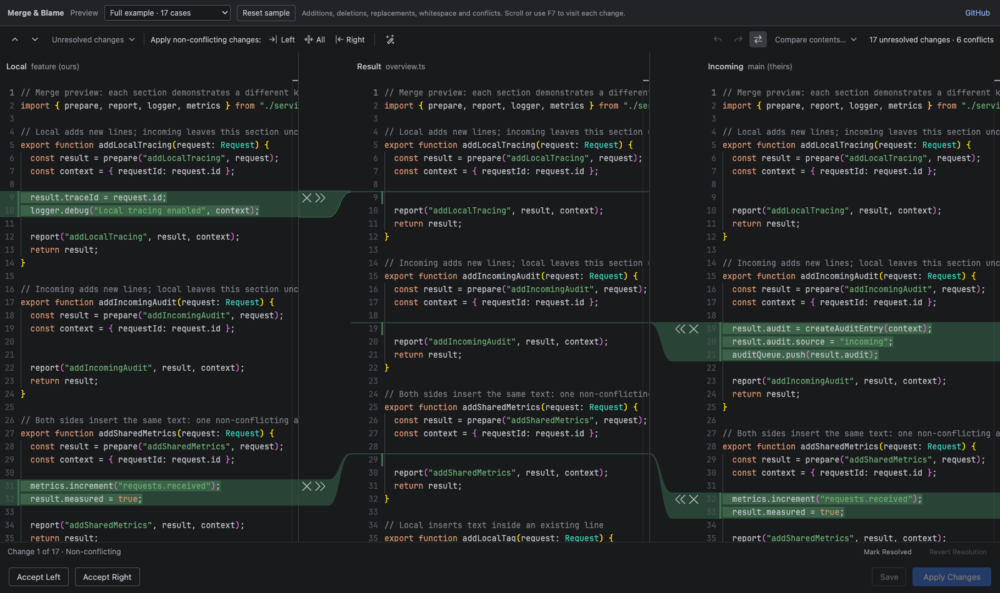

# Merge & Blame

An IntelliJ-style three-way merge editor and Git blame for VS Code.

[Try the live preview](https://sammyvimes.github.io/vscode-merge-and-blame/)
with representative merge samples, apply/ignore controls, magic wands, and demo
blame history. All demo edits stay in your browser.



**Local → editable Result ← Incoming**

Apply or ignore individual changes using the arrows and × buttons beside the
code. All merging runs locally with deterministic algorithms. No AI service,
telemetry, Java runtime, or JetBrains installation is required to use it.

## Install and use

1. Install the generated `merge-and-blame-0.3.0.vsix` using **Extensions: Install
   from VSIX…** in VS Code's Command Palette.
2. With a conflicted Git repository open, run **Merge & Blame: Resolve Git
   Conflicts** and select a file. You can also right-click a file under **Merge
   Changes** in Source Control and select **Merge & Blame: Open File**.
3. Resolve changes and review the middle pane. **Save** writes the result without
   staging it. **Apply Changes** saves and stages that file once all its
   changes are resolved. Finish the repository's merge or rebase in your usual
   Git workflow.

The result initially contains the common ancestor. Enable
`threeWayMerger.autoApplyNonConflicting` to apply non-conflicting changes on open.
Saved sessions retain both the result and resolution state when reopened.

## Git blame

Right-click a file's **line numbers → Show Git Blame**. Colored date-and-author
annotations appear beside the code in the native VS Code editor. Its language
features, extensions, selections, undo history, and unsaved text stay available.
**Hide Git Blame** removes the annotations without reopening the file.

Hover an annotation or its code line and click **Open commit** to open VS Code's
native commit diff, with the blamed historical file first and focused. All files
changed in the commit are included, comparing the parent with the commit. A
custom viewer is used only if VS Code's built-in Git API is unavailable; it
shows an inline diff with highlighted removals/additions and one scrollbar.
The gutter also offers **Open Commit for Blamed Line**. Uncommitted
lines display **Not committed yet** and have no commit link. Annotations refresh
after edits, when returning to the editor, and on repository changes reported
by VS Code's Git extension.

Annotations are installed for the complete buffer. Vertical scrolling does not
fetch blame or wait for the extension host, including over SSH. The annotation
column keeps its width while edited text is being reattributed.

VS Code's public decoration API does not provide direct click handlers or a
separate fixed annotation gutter. Native blame therefore uses hover links and
annotations that scroll horizontally with the text. These are differences from
IDEA's exact click/scroll behavior. Each custom merge pane retains its directly
clickable annotation column and uses that side's Git revision.

## Controls

| Control | Action |
| --- | --- |
| » / « | Apply that side's change to the result. Applying the other side afterward appends it, matching JetBrains' per-side workflow. |
| × | Ignore that side's change. For a conflict, address both sides to finish resolution. |
| ✓ ↶ beside a resolved change | That side has been resolved. Click ↶ to revert the change and restore its apply/ignore controls. |
| Ctrl/Cmd + click an arrow or × | Resolve the whole conflict with that action. |
| Apply All Non-Conflicting Changes | Apply eligible changes from both sides throughout the current file. Conflicts and manual edits remain untouched. |
| Left / right bulk buttons | Apply non-conflicting changes from that side only. |
| Magic wand: Resolve Simple Conflicts | Apply eligible non-conflicting changes and combine resolvable word-level conflicts, matching IDEA's whole-file action. Leave ambiguous conflicts unresolved. |
| Magic wand beside a conflict in the Result gutter | Resolve just that conflict. The toolbar wand still processes the whole file. |
| Mark Resolved | Confirm a manual resolution for the selected change. |
| Revert Resolution | Restore that change's base text and unresolved state. |
| F7 / Shift+F7 | Next / previous change, using the navigation filter. |
| Undo / redo | Restore both text and resolution state, including bulk operations. Standard Ctrl/Cmd+Z and redo shortcuts work inside the editor. |
| Compare contents | Compare either input or the result against the base or another version in VS Code's diff editor. |
| Synchronize scrolling | Keep corresponding regions in view; click again to scroll independently. |
| Accept Left / Right | Replace the entire result with that version. A deleted side is explicitly labeled and accepting it deletes the file on save. |

The current file's line endings, UTF-8 BOM, and permissions are preserved when
saving. Changes to the file or conflict stages outside the editor stop a save
instead of overwriting them. Existing marker-free manual results are imported
when no saved session is available.

Rebase labels identify Git's stage 2 as the rebased-onto version and stage 3 as
the commit being replayed. Neither side is assumed to mean “my feature branch”
in every operation.

## Develop

Requires Node.js 22+ and Git. VS Code 1.100+ is the extension target.

```sh
npm ci
npm run typecheck
npm test
npm run build
npm run test:ui
npm run package
```

Press **F5** in this repository to launch an Extension Development Host. Open a
repository with actual Git conflicts in that window. `npm run preview` also
serves a standalone demonstration at `http://127.0.0.1:4173`. It opens a 195-line
example covering 17 change cases, including pure insertions from both sides and
text inserted within an existing line.
Use the Preview selector for focused insertion, deletion, replacement, conflict,
and file-boundary samples; **Reset sample** restores the original example.
Samples can be linked directly, for example `http://127.0.0.1:4173/?sample=insertions`.
The demo does not write or stage files. Its gutter also previews blame and the
commit view using explicitly labeled example history; the installed extension
reads real history from Git.

`npm run build:preview` writes a standalone static site to `site/`. Asset URLs
are relative so the demo works below a GitHub Pages project path. Pushes to
`main` run the tests, build the VSIX, and deploy this site through GitHub Actions.

Browser tests use an installed Chrome. `npm run test:host` launches an isolated
VS Code profile and temporary Git repository, exercises the real extension UI,
and verifies the resulting working tree and index. Set `VSCODE_EXECUTABLE` if VS
Code is installed elsewhere. Set `MERGER_TEST_AUTO=1` to also exercise automatic
initial application and its native undo lifecycle.
`npm run test:blame` separately verifies annotations, historical commit/file
selection, unsaved edits, native editor retention, TypeScript hovers, blank
lines, scrolling with a paused extension host, native commit diffs, commit
refresh, and native save/undo. Run
`MERGER_TEST_LEGACY=1 npm run test:blame` to check upgrading an open, unsaved
blame tab from 0.2.1 to the current VSIX, including UTF-8 BOM and CRLF
preservation. Build the current VSIX first; set `MERGER_TEST_LEGACY_VSIX` if the
old package is stored elsewhere.
`MERGER_TEST_FALLBACK_COMMIT=1 npm run test:blame` disables VS Code's Git extension
and checks the fallback's highlighted parent/commit diff and single scrollbar.

`npm run test:reference` compares 1,626 default text-resolver cases and 1,000
line-range cases with an installed JetBrains IDE. Set `JETBRAINS_HOME` to its `Contents` directory (or a directory containing
`lib/` on other platforms). This is a development check only.

See [development.md](development.md) for the goal and
[docs/intellij-reference.md](docs/intellij-reference.md) for the source revision,
test provenance, architecture, and fidelity differences.
See [docs/publishing.md](docs/publishing.md) for Marketplace publishing and the
extension's new identity.

## Scope

Supports UTF-8 text conflicts, including add/add and modify/delete conflicts.
Binary, symlink, and submodule conflicts are rejected with an explanation. The
extension is an independent implementation of the text merge workflow; it does
not include IntelliJ's language-specific PSI/import resolvers. Editor services
come from the embedded Monaco editors; other VS Code extensions' language
features are not automatically hosted inside the webview.

Apache-2.0. See [LICENSE](LICENSE), [NOTICE](NOTICE), and
[THIRD_PARTY_NOTICES.txt](THIRD_PARTY_NOTICES.txt).

This is an independent project and is not affiliated with or endorsed by JetBrains.
